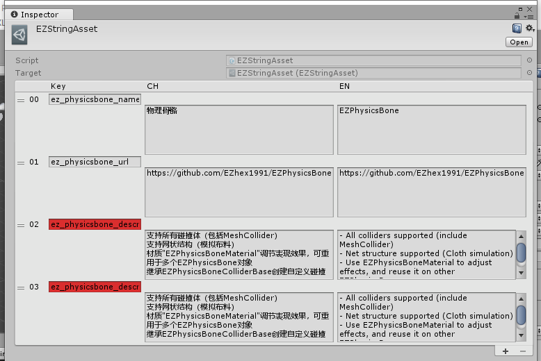
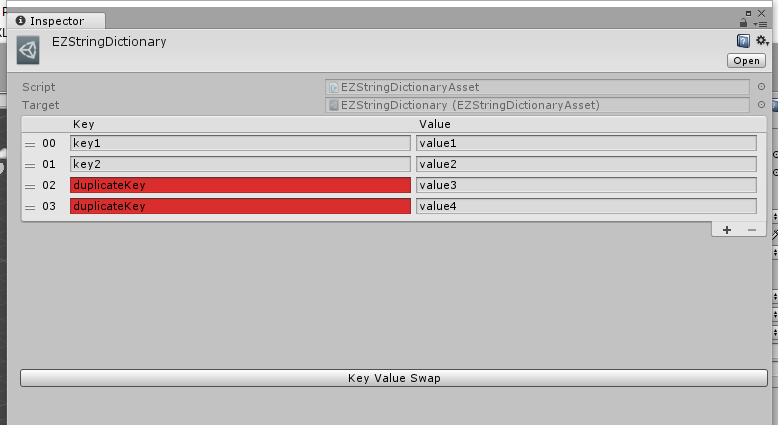

# Custom Assets

## EZStringCollection

(右键菜单/Create/EZUnity/EZStringCollection)

用来存放多语言的长文本。key 如果重复会显示在红色背景中。

## EZStringDictionary

(右键菜单/Create/EZUnity/EZStringDictionary)

用来存放一个 string 的 dictionary，设计初衷是做骨骼和变形器的名称适配。key 如果重复会显示在红色背景中。
